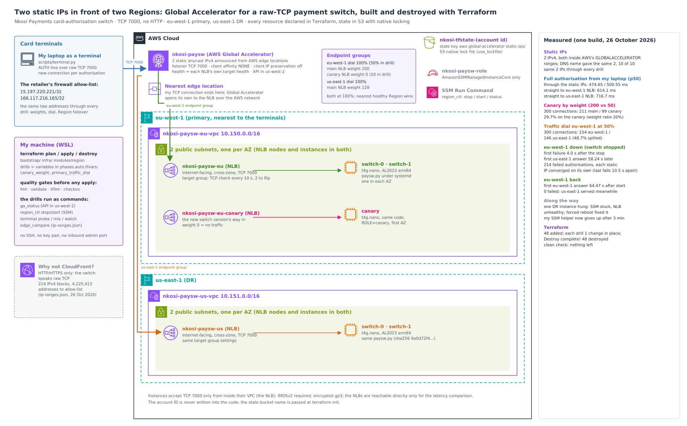

# Two static IPs, two Regions, failover without DNS: AWS Global Accelerator for a raw-TCP payment switch

I put a card-authorisation switch behind **AWS Global Accelerator**. It runs in two AWS Regions (eu-west-1 primary, us-east-1 DR), each behind its own Network Load Balancer, and the terminals only ever see **two static anycast IPv4 addresses**. Then I tested what the scenario is about:

- moving a share of traffic to a canary,
- dialling a Region down,
- killing the primary Region while a terminal authorised back to back (609 attempts in 265 s),

all without the terminals' addresses changing once. Everything is declared in **Terraform** and was built, measured and destroyed in one sitting.



## The scenario: Nkosi Payments and the firewall tickets

Nkosi Payments (a fictional company, modelled on how South African card processors work) runs the card-authorisation switch for about 400 retailers: supermarket chains, pharmacies, fuel stations. Every card terminal opens a raw TCP connection to the switch on port 7000, sends one authorisation line and waits for `APPROVED`. There is no HTTP anywhere in that path.

The retailers' networks are locked down. A terminal can only reach IP addresses that the retailer's firewall team has allow-listed. With the switch behind one load balancer in one Region, that caused three problems:

- **The addresses weren't Nkosi's to keep.** Every rebuild or move meant a change ticket at 400 retailers, and the last round took six weeks.
- **Disaster recovery only existed on paper.** Moving to the copy in the second Region meant new addresses, which meant the same 400 tickets. Some terminals hard-code addresses and others cache DNS for hours, so a DNS-based failover wouldn't reach them in time either.
- **Every release went to every terminal at once,** because nothing could send a small share of terminals to a new version first.

**What I set out to prove:**
- two addresses that never change, whatever happens behind them;
- Region failover with no DNS change and no firewall ticket;
- traffic shifting both inside a Region (endpoint weights) and between Regions (traffic dial);
- an evidence-based answer to "why not just put CloudFront in front?"

## Results

All numbers come from one build on 26 October 2026: [`docs/results/summary.txt`](docs/results/summary.txt), the raw files in [`docs/results/raw/`](docs/results/raw/), and 30 screenshots ([index](docs/screenshots.md)). Times are UTC.

| What I measured | Result |
|---|---|
| The two static IPs | `15.197.220.221` and `166.117.216.165`. Both are inside AWS's published `GLOBALACCELERATOR` ranges. The accelerator's DNS name resolved to exactly these two in 10 of 10 lookups, and they stayed the same through every drill. |
| Full authorisation from my laptop, p50 of 30 each | **474.65 / 500.55 ms** through the two static IPs, against **614.1 ms** straight to the eu-west-1 NLB and **716.7 ms** straight to the us-east-1 NLB. |
| Canary by endpoint weight (main 200, canary 50) | 300 connections: **211 main / 89 canary (29.7%)**. The weight ratio is 20%; see [traffic controls](docs/traffic-controls.md). |
| Traffic dial: eu-west-1 at 50% | 300 connections: **154 eu-west-1 / 146 us-east-1 (48.7% spilled to DR)**. |
| eu-west-1 down: switch stopped on all 3 instances | First failed authorisation **4.0 s** after the stop. First answer from us-east-1 **58.24 s** after that. **214 failed** authorisations, all fast connection resets. Their first us-east-1 answers were 3 s apart; their last failures, 10.5 s apart. |
| eu-west-1 back | First eu-west-1 answer **64.47 s** after the start command, with **0 failures**: us-east-1 kept answering until eu-west-1 took over again. |
| Why not CloudFront | It's HTTP/HTTPS only, so it can't carry the switch's raw TCP at all. Its general published range is also **214 IPv4 blocks (4,225,413 addresses)**, against 2 addresses here. |
| Terraform | `48 to add`; each weight or dial drill was `1 to change` in place, taking 31 s to 1 min 2 s; `Destroy complete! Resources: 48 destroyed.`; clean check empty. |

**The failover, second by second** ([failover drill](docs/failover.md)):

| UTC | What happened |
|---|---|
| 05:30:17.860 | Terminal starts: back-to-back authorisations (no faster than one every 0.25 s), alternating between the two static IPs. All 76 before the stop are answered by eu-west-1 (p50 458.55 ms). |
| 05:30:52.222 | I stop the switch on all 3 eu-west-1 instances through SSM. |
| 05:30:55.828 | Last answer from eu-west-1. |
| 05:30:56.252 | First failure: `ConnectionResetError`. The edge still accepts the connection, but nothing behind it answers. |
| 05:31:54.491 | First answer from us-east-1, on `166.117.216.165`. |
| 05:31:57.518 | First answer from us-east-1 on `15.197.220.221`. That IP keeps failing now and then until 05:32:04.484. |
| 05:32:20.500 | I start the switch again in eu-west-1. us-east-1 keeps answering throughout. |
| 05:33:24.968 | First answer from eu-west-1 again (`166.117.216.165`). |
| 05:33:30.705 | Last answer from us-east-1. From here on, everything is eu-west-1. |

## How it works

- **Global Accelerator** ([`infra/main.tf`](infra/main.tf)):
  - One accelerator with one TCP listener on port 7000. Client affinity is `NONE`, so every new connection is routed on its own.
  - One **endpoint group per Region**, each with a traffic dial. Both dials sit at 100%, so each terminal goes to the closest healthy Region.
  - Health comes from each NLB's own target health. Client IP preservation is off.
  - My TCP connection ends at the nearest AWS edge location, and Global Accelerator carries the traffic to the NLB over the AWS network.
- **One reusable Region module** ([`infra/modules/region`](infra/modules/region)), used twice:
  - a VPC with 2 public subnets;
  - internet-facing, cross-zone NLBs on TCP 7000 (target group TCP check every 10 s, 2 checks to flip either way);
  - `t4g.nano` Graviton instances running [`app/paysw.py`](app/paysw.py) under systemd.
  - eu-west-1 also gets a **canary NLB** with one instance, at weight 0 until I want it to take traffic.
- **The instances:**
  - They accept port 7000 only from inside their VPC, which is the NLB.
  - IMDSv2 is required and volumes are encrypted.
  - There's no SSH and no key pair: every command goes through SSM Run Command.
- **The switch** answers `AUTH <terminal> <cents> <ts>` with `APPROVED <region> <instance> <code> <ts> <peer>`. The authorisation code is derived only from the request, so the same request gets the same code in any Region. The answer also says which Region and instance handled it, which is how the drills tell where traffic went.
- **The scripts** in [`scripts/`](scripts/):

  | Script | What it does |
  |---|---|
  | `terminal.py` | Plays a card terminal: `probe` (latency), `mix` (who answered n connections), `watch` (back-to-back authorisations, then a timeline), `summarise` (rebuild that timeline from the saved log) |
  | `ssm_run.py` | Runs a shell command on instances through SSM Run Command; gives up after 3 minutes and says what it is still waiting for |
  | `ga_status.py` | The accelerator's own view of status, dials, weights and health. Its API is in us-west-2. |
  | `region_ctl.py` | Stops, starts or checks the switch in a whole Region through SSM, and logs each action with millisecond timestamps |
  | `edge_compare.py` | Compares AWS's published IP ranges for CloudFront and Global Accelerator |
  | `results.py` | Collects every measured number into one summary |

More detail: [Global Accelerator and the latency test](docs/global-accelerator.md) · [traffic controls](docs/traffic-controls.md) · [failover drill](docs/failover.md) · [CloudFront vs Global Accelerator](docs/cloudfront-vs-global-accelerator.md) · [Terraform](docs/terraform.md) · [debugging journey](docs/debugging-journey.md) · [cost](docs/cost-model.md) · [teardown](docs/teardown.md) · [decisions (ADRs)](docs/adr/)

## Why Terraform

I'd been building these environments with long chains of AWS CLI commands: create, capture an ID, feed it into the next command, and do it all again in reverse to tear down. It worked, but it was slow and repetitive, and a missed delete meant a surprise on the bill. Here, two Regions, three load balancers, five instances and an accelerator are one `terraform apply`. Each drill is a one-line variable change (`canary_weight = 50`, `primary_traffic_dial = 50`) that Terraform turns into exactly one in-place update. The whole thing is one `terraform destroy`. State lives in a shared S3 bucket with S3-native locking.

## What went wrong, and what I changed

The full story is in [docs/debugging-journey.md](docs/debugging-journey.md).

- **My first apply ended without creating anything,** and I hadn't kept its output. Re-applying the saved plan then failed with `Saved plan is stale`, because the state had changed. I re-planned and applied with the output going to a file as well as the screen. Every apply since then is logged.
- **One DR switch hung.** An SSM status command stayed `InProgress` and its NLB target went `unhealthy` (`Target.FailedHealthChecks`), while EC2's own status checks still said `ok`. A reboot request only took effect about 4 minutes later (consistent with EC2 forcing a reboot after an unclean shutdown); after it, systemd started the switch and the target was healthy again. The console log shows no error, so I can't name the cause, and I say so in the notes.
- **My SSM helper had no time limit,** so that hang froze it too. It now gives up after 3 minutes and reports what it's still waiting for every 15 seconds.
- **My drill summary got two fields wrong.** "Last answer from the stopped Region" was taken from after the restart, and the failure count missed 5 on-and-off failures (209 instead of 214). I fixed the logic and rebuilt the summary from the saved raw log. The as-run version is kept in [`docs/results/raw/`](docs/results/raw/).
- **Before the build, I reviewed the code against how AWS behaves.** That led to four changes:
  - the two endpoint groups are created one after the other, not in parallel;
  - the systemd unit got an `[Install]` section, so the switch starts after a reboot;
  - the probe compares full authorisation times, because a static IP's "connect" time only reaches the edge;
  - the drill expects connection resets, not refusals.

## Compliance and frameworks

These are the frameworks this design genuinely touches, and where I deliberately stopped short in a lab.

| Framework | What applies here | What I built | Gap I'd close in production |
|---|---|---|---|
| **PCI DSS v4.0** | Req. 1 (network security controls), 2 (secure configurations), 6 (change control), 12.10 (incident response tested) | Instances reachable on 7000 only from their VPC; no inbound admin port; IMDSv2; encrypted volumes; every change through reviewed Terraform; a failover drill with a measured timeline | The `AUTH` line is plaintext. A real switch carries cardholder data, so it needs TLS (Req. 4). Also VPC flow logs and NLB access logs (Req. 10). |
| **ISO/IEC 27001:2022** | A.5.30 ICT readiness for business continuity, A.8.14 redundancy of information processing facilities, A.8.20 network security, A.8.32 change management | A second Region, failover tested end to end, traffic shifting by weight and dial, infrastructure as code | Regular scheduled drills, and recovery objectives agreed with the business |
| **NIST SP 800-53 Rev. 5** | CP-2 / CP-4 contingency plan and testing, CP-7 alternate processing site, SC-7 boundary protection, CM-2 / CM-3 baseline and change control | The same items as above | CP-4 evidence on a schedule, not once |
| **South Africa: Prudential Authority / FSCA Joint Standards** | Joint Standard 1 of 2023 (IT governance and risk management) and Joint Standard 2 of 2024 (cybersecurity and cyber resilience) bind the banks and acquirers a processor like Nkosi serves; they pass resilience and recovery-testing expectations on to their critical service providers | A tested Region failover with measured impact (214 failed authorisations in about 68 s, 0 on the way back) | Formal recovery objectives and evidence kept for the regulator |

## Repo layout

```
app/paysw.py                  the payment switch (TCP 7000), copied to every instance at boot
bootstrap/                    the shared Terraform state bucket (one-time)
infra/                        accelerator, listener, endpoint groups, IAM; modules/region used twice
infra/templates/              instance boot script (systemd unit for the switch)
scripts/                      terminal, ga_status, region_ctl, ssm_run, edge_compare, results
docs/                         architecture, write-ups, ADRs, results (CSV + raw), screenshots
```

## Reproduce it

From the repo folder, with AWS CLI v2, Terraform 1.11 or newer, Python 3, and an existing state bucket (or `bootstrap/` applied once):

```bash
cp env.sh.example env.sh && mkdir -p build/results && source ./env.sh
terraform -chdir=infra init -backend-config="bucket=<your state bucket>"
terraform -chdir=infra plan -out=base.tfplan && terraform -chdir=infra apply base.tfplan   # 48 resources, about 5 minutes
python3 scripts/ga_status.py --wait --label base
python3 scripts/terminal.py probe --n 30
echo 'canary_weight = 50' >> infra/phases.auto.tfvars && terraform -chdir=infra apply      # 1 to change
python3 scripts/terminal.py mix --label canary-50 --n 300
python3 scripts/terminal.py watch --label failover          # terminal A
python3 scripts/region_ctl.py stop primary                  # terminal B, then: start primary
terraform -chdir=infra destroy                              # 48 destroyed
```

It costs about US$0.18 an hour while running ([cost model](docs/cost-model.md)). Always destroy afterwards ([teardown and clean check](docs/teardown.md)).

## What I'd tell the next team

- **Static anycast IPs change the conversation with customers' firewall teams.** It's one allow-list entry per address, made once. After that, Regions, load balancers and instances can change behind it without a single ticket.
- **Failover without DNS is fast, but not instant.** I measured about a minute from the first failure to the first answer from the other Region. Terminals need to retry a failed authorisation rather than give up: the failures were resets that came back in about a quarter of a second, so a retry costs little.
- **Each static IP converged separately:** their last failures were 10.5 s apart. Terminals that only know one of the two IPs will see different outage windows, which is one more reason to configure both.
- **Measure a canary split from the load balancers, not from one client.** My single-machine sample gave 29.7%, not the 20% the weights imply. In production I'd judge the split from the NLBs' own connection metrics over a longer window.
- **Watch target health per instance, not just endpoint health.** An NLB endpoint counts as healthy while any one of its targets is, so a single hung instance can hide behind a healthy endpoint.
